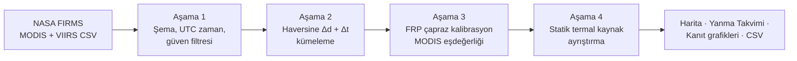

# KÖZ Atlas

**MODIS & VIIRS Termal Anomali ve Aktif Yangın Harmonizasyon Platformu**

| | |
|---|---|
| Yarışma | 2026 NASA Space Apps Challenge — Batman Yerel Etkinliği (Prof. Dr. Narin Nasıroğlu Bilim ve İnovasyon Merkezi, 14–15 Kasım 2026) |
| Görev | [Harmonization of MODIS and VIIRS Hot Spots](https://www.spaceappschallenge.org/2026/challenges/modis-and-viirs-hot-spots/) (İleri Seviye) |
| Takım | **Kirvecanlar** — Batman Üniversitesi Bilgisayar Mühendisliği |
| Canlı uygulama | https://koz-atlas-gbqjscepvmqcaygzbjlxhq.streamlit.app/ |
| Depo | https://github.com/MehmetHalilKILIC/koz-atlas |
| Veri | NASA FIRMS Area API ve arşivi — [Space Apps FIRMS kılavuzu (#2016)](https://github.com/nasa/spaceapps/discussions/2016) |

| Üye | Rol |
|---|---|
| Mehmet Halil KILIÇ (Kaptan) | Veri mühendisliği, Haversine ve FRP harmonizasyon algoritması |
| İbrahim Halil BİRLİK | Backend, CBS harita entegrasyonu, Streamlit mimarisi |
| Mirze KARA | Veri analitiği, Yanma Aktivitesi Takvimi, sunum stratejisi |

---

## 1. Problem

- **MODIS** (Terra, Aqua): 2000'den beri aktif yangın / termal anomali kaydı, ~1 km × 1 km piksel; görev ömrünün sonuna yaklaşıyor.
- **VIIRS** (Suomi NPP, NOAA-20, NOAA-21): 375 m × 375 m piksel, daha yüksek termal hassasiyet.
- İki kayıt ham sayılarla birleştirilemez: tek bir 1 km MODIS pikselindeki yangın VIIRS'te **birden çok alt piksel** olarak görünür ve VIIRS, MODIS'in kaçırdığı **düşük enerjili küçük yangınları** da yakalar. Sonuç: 2012 sonrasında yapay bir "yangın sayısı sıçraması" ve mevcut sezonu 20+ yıllık tarihsel medyanla doğru kıyaslayamama.

## 2. Çözüm: 4 aşamalı harmonizasyon boru hattı



### Aşama 1 — Veri çekme, şema standardizasyonu, güven filtresi
- FIRMS Area API: `https://firms.modaps.eosdis.nasa.gov/api/area/csv/{MAP_KEY}/{SOURCE}/{AREA_COORDS}/{DAY_RANGE}/{DATE}`; istekler 10 günlük parçalara bölünür.
- Kaynaklar: `MODIS_NRT`, `MODIS_SP`, `VIIRS_SNPP_NRT`, `VIIRS_SNPP_SP`, `VIIRS_NOAA20_NRT`. FIRMS arşiv CSV'leri doğrudan da yüklenebilir.
- MODIS `brightness`/`bright_t31` ve VIIRS `bright_ti4`/`bright_ti5` ortak sütunlara eşlenir.
- Ortak güven ölçeği: MODIS 0–100 → `low` (<30), `nominal` (30–79), `high` (≥80); VIIRS `l`/`n`/`h` → `low`/`nominal`/`high`. Varsayılan filtre `low` kayıtları çıkarır.
- `acq_date` + `acq_time (HHMM)` → `utc_timestamp`.
- AOI ön ayarları (W,S,E,N): Türkiye geneli `25.6,35.8,44.8,42.1`; Güneydoğu Anadolu & Batman Havzası `38.5,36.6,43.5,38.8`; Akdeniz & Ege Orman Kuşağı `26.0,36.0,36.5,40.0`; özel kutu.

### Aşama 2 — Haversine mekansal-zamansal kümeleme
$$d = 2R \arcsin\left(\sqrt{\sin^2\left(\frac{\Delta \phi}{2}\right) + \cos\phi_1\cos\phi_2\sin^2\left(\frac{\Delta \lambda}{2}\right)}\right),\quad R = 6371.0\ \text{km}$$

- Kenar koşulu: `d ≤ Δd` (varsayılan 1.2 km, arayüzde 0.5–2.5 km) **ve** `|Δt| ≤ ±60 dk` (arayüzde 10–180 dk).
- Aday çiftler 4 boyutlu KD-ağacında (birim küre x, y, z + ölçeklenmiş zaman) bulunur, tam Haversine ile doğrulanır; bağlı bileşenler = **Harmonize Yangın Olayı** (`KOZ-YYYYMMDD-sıra`).
- Olay merkezi: FRP ağırlıklı ağırlık merkezi. Etiket: `BOTH (MODIS+VIIRS)`, `VIIRS_CLUSTER_HARMONIZED`, `MODIS_ONLY`; `merged_pixel_count` kaydedilir.

### Aşama 3 — FRP çapraz kalibrasyonu ve MODIS eşdeğerliği
- Sensör FRP'si: uydu geçişi içinde piksel toplamı, aynı olaydaki farklı geçişler arasında ortalama (iki VIIRS uydusu aynı yangını iki kez toplamaz).
- Kalibrasyon katsayıları **sabit varsayılmaz, veriden öğrenilir**: `BOTH` olaylarında `log10(FRP_MODIS) = a + b·log10(FRP_VIIRS)` (EKK). Alternatif: orijinden doğrusal veya kalibrasyonsuz. Eş-konumlu çift < 10 ise kimlik dönüşümü.
- `calibrated_frp_mw`: MODIS gözlemi olan olayda MODIS FRP (referans sensör), yalnız-VIIRS olayda kalibre VIIRS FRP.
- **MODIS tespit eğrisi**: VIIRS olaylarında MODIS'in de gördüğü oran, kalibre FRP sınıflarına göre hesaplanır, yüksek FRP platosuna normalize edilip monotonlaştırılır → `modis_eq_weight`.
- **Aktif yangın hücre-günü**: olaylar ~1 km grid × UTC gün düzeyinde toplanır, ağırlık = hücre-gündeki en yüksek `modis_eq_weight`. Uydu sayısı değişse de (Terra/Aqua → +Suomi NPP → +NOAA-20) seri aynı ölçekte kalır.

### Aşama 4 — Statik termal kaynak tespiti
- ~1 km grid hücresinde, **aynı yıl içinde** ≥ 5 farklı gün **ve** ≥ 4 farklı ay olay → `is_static_source = True` (Statik Endüstriyel Termal Kaynak). Mevsimsel anız/orman yangınları bu kalıcılığı göstermez → `False` (Dinamik Biyokütle Yangını).
- Hücre sınırı etkisi için yarım hücre kaydırılmış ikinci grid; komşu statik hücreler tek tesis (`STK-###`) olarak birleştirilir. Eşikler arayüzden ayarlanır.

## 3. Web uygulaması

| Bileşen | İçerik |
|---|---|
| Kenar çubuğu | AOI, veri kaynağı (sentetik demo / canlı FIRMS API / CSV yükleme), tarih aralığı, Δd, Δt, güven eşiği, statik kaynak gizleme, kalibrasyon modeli |
| KPI kartları | Ham sıcak nokta, harmonize olay, duplikasyon azaltma %, statik kaynak sayısı, ortalama kalibre FRP |
| Sekme 1 | Folium CBS haritası: ham MODIS (1 km çember), ham VIIRS (375 m çember), KÖZ olayları (popup), statik kaynaklar |
| Sekme 2 | Yanma Aktivitesi Takvimi: Yıl × Ay ısı matrisi, seçilen ayın tarihsel medyana oranı, yüzdelik, Ç1–Ç3 bandı, mevsimsel profil |
| Sekme 3 | Harmonizasyon kanıtı: yıllık ham / harmonize seriler, 2012 kırılma oranı, MODIS–VIIRS FRP korelasyonu, MODIS tespit eğrisi |
| Sekme 4 | `koz_atlas_harmonized_hotspots.csv`, statik kaynak listesi, piksel→olay eşleme tablosu, çalıştırma meta verisi (JSON) |

> **Demo verisi hakkında:** API anahtarı olmadan açılan mod, FIRMS CSV şemasında üretilmiş **sentetik simülasyon** verisi kullanır (`harmonizer.SyntheticFIRMSGenerator`). Gerçek uydu gözlemi değildir; konumlar, yangın sayıları ve statik kaynaklar temsilidir. Gerçek analiz için FIRMS MAP_KEY girin veya FIRMS arşiv CSV'si yükleyin.

## 4. Kurulum ve çalıştırma

```bash
git clone https://github.com/MehmetHalilKILIC/koz-atlas.git
cd koz-atlas
pip install -r requirements.txt
streamlit run app.py
```

Testler:
```bash
python tests/test_harmonizer.py   # motor birim testleri
python tests/test_app.py          # arayüz duman testi (headless)
```

Sunum dosyası (7 slayt, PPTX):
```bash
pip install python-pptx
python presentation/build_presentation.py   # -> presentation/KOZ_Atlas_Sunum.pptx
```

## 5. Dizin yapısı

```
koz-atlas/
├── app.py                         Streamlit arayüzü (4 sekme)
├── harmonizer.py                  Bilimsel motor (Aşama 1–4, FIRMS istemcisi, sentetik veri üreteci)
├── requirements.txt
├── .streamlit/config.toml         Koyu uzay / kor teması
├── tests/
│   ├── test_harmonizer.py
│   └── test_app.py
├── presentation/
│   ├── SUNUM.md                   7 slaytlık 5N1K sunum metni ve konuşma betiği
│   └── build_presentation.py      PPTX üretici
└── README.md
```

## 6. Sınırlamalar

- Tek bağlantılı kümeleme, çok yoğun yangın cephelerinde zincirleme ile büyük kümeler oluşturabilir; Δd küçültülerek kontrol edilir.
- FRP kalibrasyonu ve MODIS tespit eğrisi, seçilen bölge/dönemdeki eş-konumlu olaylardan öğrenilir; az veride kimlik dönüşümüne ve ağırlık 1'e düşer.
- Statik kaynak eşikleri sezgiseldir; farklı bölgelerde ayar gerektirebilir.
- FIRMS NRT kaynakları yakın dönemi kapsar; uzun dönem analiz için SP (standart işlem) kaynakları veya arşiv CSV'leri kullanılmalıdır.

## 7. Kaynakça

1. NASA Space Apps Challenge 2026 — Harmonization of MODIS and VIIRS Hot Spots: https://www.spaceappschallenge.org/2026/challenges/modis-and-viirs-hot-spots/
2. NASA Space Apps GitHub tartışması ve FIRMS Area API kılavuzu (#2016): https://github.com/nasa/spaceapps/discussions/2016
3. KÖZ Atlas canlı uygulama: https://koz-atlas-gbqjscepvmqcaygzbjlxhq.streamlit.app/
4. KÖZ Atlas GitHub deposu: https://github.com/MehmetHalilKILIC/koz-atlas
